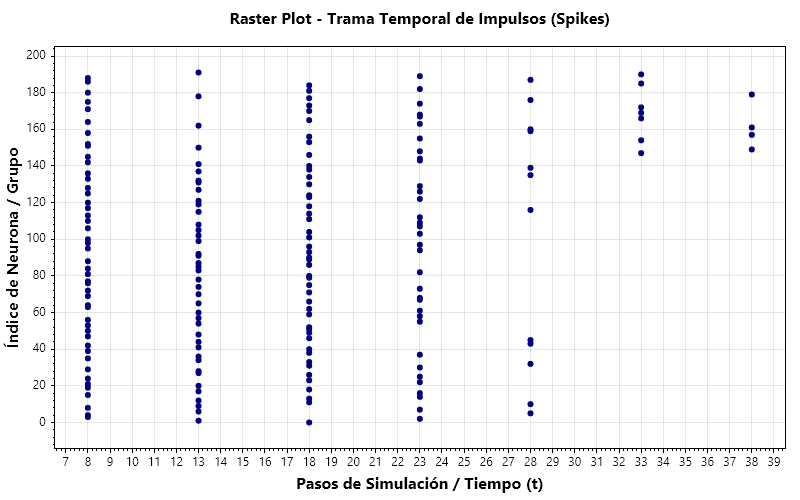
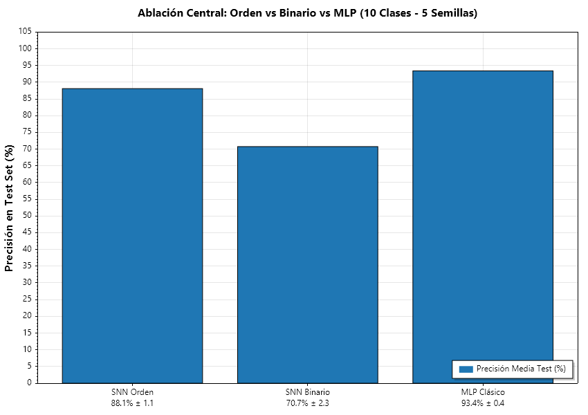
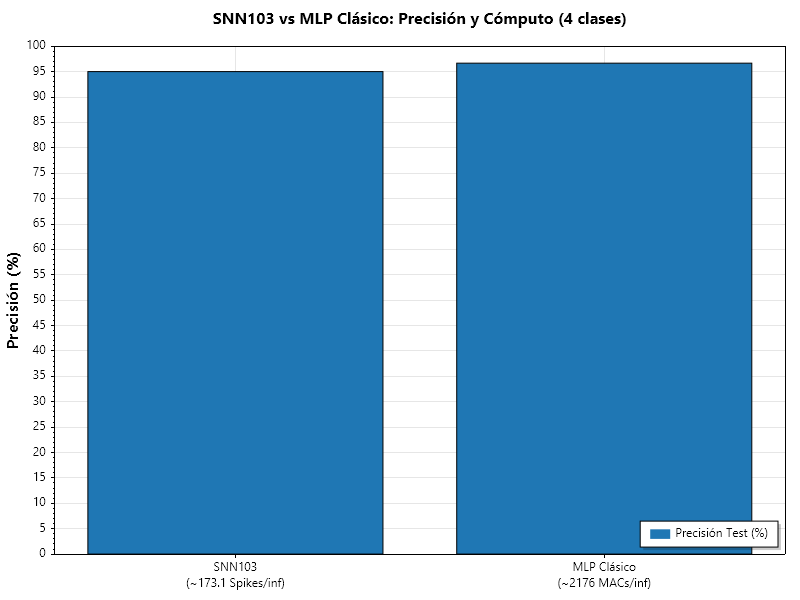
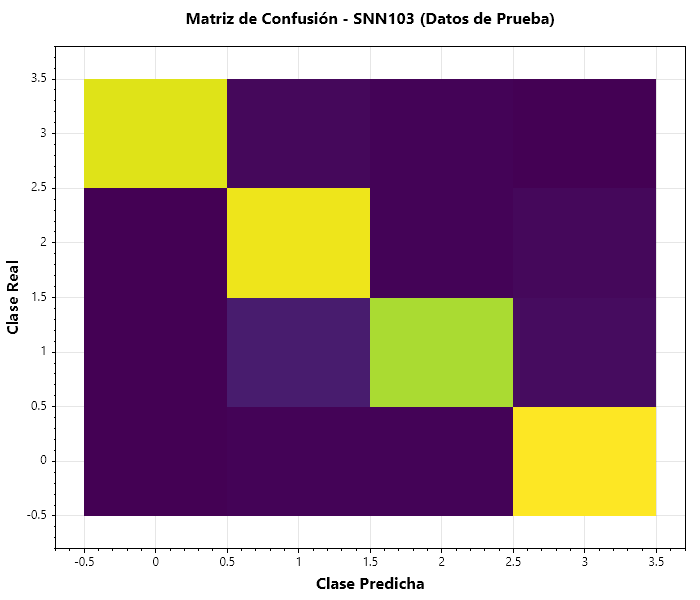

# Learning to Use Spike Order: Rank-Order Dictionaries Beat Binary Features by 17 Points at a Fraction of the Events

**Author:** Erisnel Lora Sugve  
**Affiliation:** Independent Researcher, Santiago de Cuba, Cuba  
**Email:** `lorasugve@gmail.com` | **ORCID:** [0009-0007-2047-9345](https://orcid.org/0009-0007-2047-9345)  
**Code & Data:** Public repository [github.com/sharkcode1001/SNN103](https://github.com/sharkcode1001/SNN103)  
**Publication Status:** Technical Preprint — October 2026

---

## Abstract

Spiking neural networks usually waste their temporal code by using only firing rates. Starting from the observation that *n* parallel pulses encode *n!* arrival orders (the B103 line code), we show a recipe that actually works: small subregions of 4 LIF neurons, burst-driven inputs, a supervised pairwise rule that teaches order dictionaries, and coincidence coding to compose levels ("zones of zones"). The central test: with the *same fixed layer* and the *same seeds*, order features (1/rank) beat binary features (fired / did not fire) by about **17 points** on handwritten digits 0–9 (**88.1% vs 70.7%**, mean over 5 seeds) — the order carries information; it is not decoration. We also report: a 6-symbol order dictionary learned in 13 epochs with 100% identification under noise; subregions of 4 that survive noise where a group of 8 collapses (98.9% vs 62.3% correct orders); and two levels that solve an XOR-like composition by coincidences (100% vs 50%). As an honest reference, a classic MLP reaches 93.4% on the same task at ~14× more events per decision; a pre-registered sweep over 12/16/24 groups per strip shows that more random features do not close that gap (stopped by the agreed criterion) — the current ceiling is the fixed front-end, which does not learn. We report everything that failed, too.

---

## 1. Introduction

The starting idea is simple and comes from line coding: *n* parallel pulses do not just carry *n* bits — they carry their **arrival order**, *Z = n!* possible zones (the B103 code). The question of this work is whether a neural network can **learn to use** those orders, not merely exhibit them.

Why it matters: event-driven, sparse computation fits low-power sensing and edge hardware. This work does not compete with transformers on language; it asks whether spike order can become a trainable, measurable code.

The paper is organized as follows. Section 2 reviews the related work briefly. Section 3 describes the neuron model, the subregion design, the supervised pairwise rule, coincidence composition, and the readout. Section 4 reports six experiments, from code capacity to the central 10-class ablation. Section 5 summarizes the results and the honest limits, including everything that failed. Section 6 discusses the open problem — a front-end that learns — and Section 7 concludes.

**Contributions.**

1. **Order matters: a clean order-vs-binary ablation.** Same fixed layer, same 5 seeds, digits 0–9: order features (1/rank) 88.1±1.1% vs binary features (fired/did not fire) 70.7±2.3%. About 17 points that only the order code can explain.
2. **A supervised dictionary of first-spike permutations.** To the best of our knowledge (reviewed Oct 2026), no published work trains the full first-spike permutation as a supervised code. We do it with a pairwise rule applied on real LIF dynamics: 6 symbols in 13 epochs, 100% identification under noise.
3. **Small subregions as the robust unit.** Measured: under the same noise, 2×4 neurons give 98.9% correct orders vs 62.3% for 1×8; 4×4 give 97.4% with 331,776 combined codes.
4. **Composition by coincidences ("zones of zones").** An upper layer listening to coincidence channels solves combinations a single level cannot (XOR-like task: 100% vs 50%).
5. **An honest MLP reference plus a measured limit.** On 10 classes the MLP reaches 93.4±0.4% at ~14× more events per decision (~169 spikes vs 2368 multiplications). A sweep over 12/16/24 groups per strip, with a stop criterion agreed *before* running, shows more random features do not close the gap (**STOP**): the ceiling is the fixed front-end, which does not learn. That limit is in the paper, not under the rug.

---

## 2. Related work (brief)

**Rank-order coding in SNNs.** Since Thorpe and colleagues, the code exists as a concept — the first spikes carry the information — but it was never trained as a supervised dictionary.

**Differentiable sorting.** NeuralSort, SoftSort and Gumbel-Sinkhorn provide the technical bridge for learning permutations, but nobody had used them to train first-spike permutations end-to-end (reviewed Oct 2026).

**Spiking transformers.** Max-Former and followers advanced the field (e.g. 82.39% on ImageNet), but their energy figures are theoretical, with no measurement at scale on real neuromorphic hardware.

**Efficient alternatives.** Mamba/Jamba show that the shortcut must be structural, not an approximation — a lesson we take seriously (cf. FlashAttention).

**Classical STDP.** In our tests, STDP alone could not assign order dictionaries (~45% on overlapping patterns).

---

## 3. Method

### 3.1 Neuron and dynamics

Leaky integrate-and-fire neurons with adaptive threshold and **commit firing** (a spike is emitted after 4 consecutive steps above threshold). Lateral inhibition is implemented as a threshold jump (+0.6, decaying at 0.05 per step). Inputs arrive in **bursts** (8 bursts, one every 5 steps, over 80 trial steps): this makes the order a genuine ranking across distinct times, not a tie. With **presence coding**, a silent input channel emits nothing — silence is also information.

### 3.2 Subregions

Groups of **4 neurons** are the unit. The justification is empirical (Section 4.2): under jitter, small groups keep their orders while a group of 8 loses them.

### 3.3 Supervised pairwise rule (dictionaries)

Given a target order, for every misordered pair (A should fire before B): increase the drive of the late neuron and decrease the drive of the early one on the active channels. Ten lines of pseudocode:

```
for each training pattern p with target order T:
    run the group, observe produced order O
    for each pair (A, B) with A before B in T but B before A in O:
        w[B, active channels] += eta    # the late one needs more drive
        w[A, active channels] -= eta    # the early one needs less
```

### 3.4 Coincidences

To compose levels, the upper layer listens to **coincidence channels**: a channel is active only if a given pair of symbols is reported at the same time by two lower groups. Without this, a single layer cannot solve the XOR-like task: the corrections cancel out (demonstrated in Section 4.4).

### 3.5 Readout

On clean dictionaries: vote across groups. On real data: a perceptron over 1/rank features (fixed random front-end + statistical learner — see Section 5 for why).


**Figure 1.** Architecture used in Experiments 4.5–4.6: the 8×8 image is split into 4 strips; each strip feeds 12 fixed groups of 4 LIF neurons; each group emits a first-spike order; the 192 order features (1/rank) feed a perceptron readout.

---

## 4. Experiments

### 4.1 Capacity of the order code (n = 8; 40,320 permutations)

With 8 neurons (one spike each), the output is the full first-spike permutation. Result: **100%** correct orders without noise, **95.4%** with jitter below 1 step, **60.5%** with ~2 steps of jitter. *What it shows: the code exists but is noise-sensitive — this motivates 4.2.*

### 4.2 Subregions against noise (noise 0.06)

Same noise level, different groupings: 1×8 neurons: **62.3%** · 2×4: **98.9%** · 4×4: **97.4%** (331,776 combined codes) · 8 groups of 3 with voting: 84.2%. *What it shows: small groups survive; 4×4 is the sweet spot.*


**Figure 2.** Spike raster of one trial (192 neurons, 80 steps): the input arrives in 8 bursts (period 5 steps); within each burst the neurons fire in an input-dependent order — the order is the code. (Original figure in Spanish.)

### 4.3 Supervised dictionary (6 symbols)

The pairwise rule (3.3) converges in **13 epochs** on 6 target orders. With input noise: **86.6%** strict exact orders, **100%** symbol identification (untrained baseline: 26.7%). *What it shows: the network learns to use orders.*

### 4.4 Two levels: XOR-like task

24 inputs in 2 halves; level 1 = 16 groups of 4 (8 per half) learning 4 local symbols with the pairwise rule; level 2 = 4 groups of 4 listening to **coincidences** between halves, learning 2 classes; output by vote. Each half alone is ambiguous. Result: level 1 alone **50.0%**; two levels **100.0%** with noise, ~79 spikes/decision. The honest failure on the way: with additive (one-hot) coding the upper layer learned nothing — weights froze because every channel appears in both classes and corrections cancel (the classic single-layer XOR limitation); coincidences solved it. *What it shows: the hidden layer composes; "zones of zones" works.*

### 4.5 Digits 0–9: order-vs-binary ablation (5 seeds — the central test)

Data: `sklearn.datasets.load_digits`, 1797 samples of 8×8 pixels binarized at threshold >8, labels 0–9. Per seed (42, 1, 2, 3, 4): stratified 50/50 train/test split, a fresh fixed front-end (48 groups of 4 over 4 strips, deterministic seeds), and both feature sets extracted from the *same* simulation: **order** features (1/rank per firing neuron) vs **binary** features (fired/did not fire). A perceptron readout is trained on each (≤500 epochs). A classic MLP 64→32→10 is trained on the same splits as reference (300 epochs, lr 0.3).

Test accuracy, mean ± std over 5 seeds: **order 88.1±1.1% · binary 70.7±2.3% · MLP 93.4±0.4%**.


**Figure 3.** Core ablation (10 classes, 5 seeds): order features beat binary features by ~17 points with the identical fixed layer and seeds; the classic MLP is the honest reference.

*What it shows: ~17 points attributable to the order code alone.* (An earlier 4-class pilot, one seed: SNN103 95.0% vs MLP 96.7% — Figure 4.)


**Figure 4.** 4-class pilot: SNN103 reaches 95.0% at ~173.1 spikes + 768 readout multiplications per decision; the classic MLP 64→32→4 reaches 96.7% at 2176 multiplications per decision.


**Figure 5.** Test-set confusion matrix of the 4-class pilot (361 unseen samples): clean diagonal separation. (Original figure in Spanish.)

### 4.6 Group sweep and MLP reference (12/16/24 groups per strip, pre-registered stop criterion)

Criterion agreed *before* running: success if the gap to the MLP ≤ 2 points; stop if with 24 groups the gap is still > 3 points.

| groups/strip | order | binary | MLP 64→32→10 | gap |
|---|---|---|---|---|
| 12 | 88.1±1.1 | 70.7±2.3 | 93.4±0.4 | 5.3 pts |
| 16 | 87.9±1.0 | 70.5±1.3 | 93.4±0.4 | 5.5 pts |
| 24 | 87.5±1.0 | 69.9±4.7 | 93.4±0.4 | 5.8 pts |

**Result: STOP.** More random features do not help (88.1 → 87.5); the ablation holds in all three configurations (+17–18 points order vs binary). Cost per decision: ~169 spikes + 1920/2560/3840 readout multiplications vs 2368 for the MLP — at 24 groups even the multiplication advantage disappears (3840 vs 2368); the event advantage remains ~14× (2368/169). *What it shows: the ceiling is the fixed front-end, which does not learn; the event efficiency holds.*

---

## 5. Results and honest limits

Final comparative table:

| experiment | SNN103 | reference | cost |
|---|---|---|---|
| Order vs binary ablation, 10 classes × 5 seeds | **88.1±1.1%** | binary 70.7±2.3%; MLP 93.4±0.4% | ~169 spikes + 1920 mults vs 2368 mults |
| 4-class pilot, 361 test samples | **95.0%** | MLP 64→32→4: 96.7% | ~173.1 spikes + 768 mults vs 2176 mults |
| Subregions vs noise (0.06) | 2×4: **98.9%** | 1×8: 62.3% | — |
| Supervised dictionary, 6 symbols | 13 epochs, **100%** id. under noise | untrained: 26.7% | — |
| Two levels, XOR-like | **100%** | level 1 alone: 50% | ~79 spikes/decision |
| Group sweep 12/16/24 | 88.1 → 87.5% | MLP 93.4±0.4% | **STOP** (gap 5.3 → 5.8) |

**What did not work** (in the paper, not hidden):

- An arbitrary 24-permutation dictionary did not converge (contradictory demands).
- Additive coding on the XOR-like task: weights froze (cancellation); coincidences solved it.
- STDP alone for dictionaries: ~45%.
- An earlier order-vs-binary tie (84%) was degenerate: each group fired a single neuron.
- **The 12/16/24 sweep with a pre-agreed stop rule:** more random features do not close the MLP gap (5.3 → 5.8 pts). The fixed front-end does not learn — it is the current design limit.
- The pairwise rule is a *dictionary* learner, not a statistical one: it failed on 359 overlapping patterns (0.3%). For real data, the working recipe is fixed order expansion + perceptron.
- **Compute caveat:** the advantage is in *events* (~14× fewer: ~169 spikes vs 2368 multiplications). In pure multiplications, 12 groups give 1.2× (1920 vs 2368) and 24 groups invert it (3840 vs 2368). Simulating 80 steps on a PC gives no wall-clock advantage; the argument follows the field's standard for neuromorphic hardware, which we could not test.

---

## 6. Discussion and future work

**The open problem:** a front-end that learns from real data. The pairwise rule learns dictionaries; it is not a statistical learner. Without that, the ceiling is fixed randomness — the 12/16/24 sweep measured it.

More data and other spike benchmarks; theory still missing: convergence of the pairwise rule, how many orders survive jitter (effective capacity < n!). The "payload" per neuron beyond the order (the `abcd` of B103) was left out of this work. And real measurement on neuromorphic hardware.

---

## 7. Conclusion

A spiking network **can** learn order dictionaries and compose them across levels; and order is not decoration: it contributes ~17 points over binary features on the same layer. With a fixed front-end it reaches 88% on 10 classes at ~14× fewer events than an MLP (93.4%). The way to close the gap is a front-end that learns, not more random features — measured, not assumed. The order code stops being a curiosity and becomes trainable and measurable. Hardware and scale remain the road ahead.

---

## Data and code availability

All numbers in Sections 4.5–4.6 come from the repository `sharkcode1001/SNN103` (console prototype, .NET 10), which ships the three CSV files used (`digitos_train.csv`, `digitos_test.csv` — classes 0–3, 359/361 samples — and `digitos10_all.csv` — 1797 samples, classes 0–9) in its output folder on every build, so anyone can re-run the experiments and verify the reported figures. Experiments 4.1–4.4 were run on earlier prototype versions; their measured outputs are reported as recorded.
